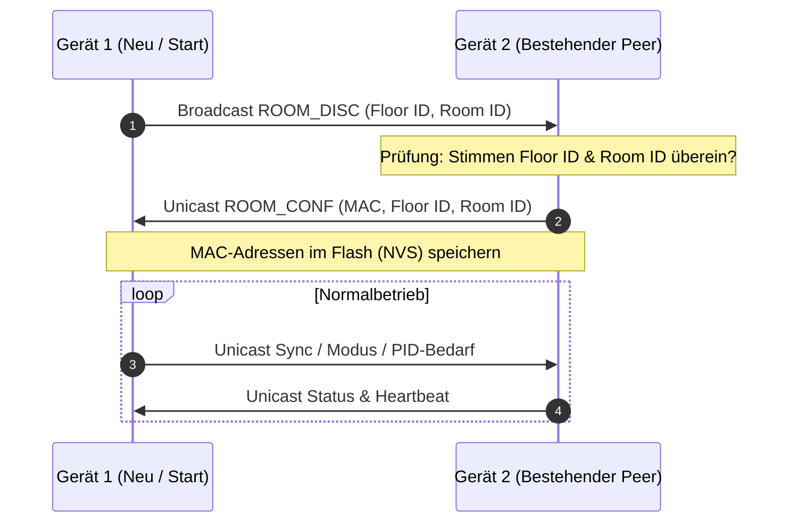

# 📡 ESP-NOW Funk-Mesh & Raum-Synchronisation

VentoSync nutzt **ESP-NOW** (über die [ESPHome ESP-NOW Komponente](https://esphome.io/components/espnow.html)) für die direkte, ultra-latenzarme Kommunikation von Gerät zu Gerät. ESP-NOW arbeitet direkt auf der MAC-Schicht im 2,4-GHz-Band, ohne Umweg über einen zentralen WLAN-Router oder Steuerkabel.

  

---

## 💡 Architekturentscheidung: Warum ESP-NOW statt Powerline (PLC)?

Kommerzielle Systeme wie das originale VentoMaxx setzen auf **Powerline Communication (PLC)** über die 230V-Stromleitung, um Lüfterpaare zu synchronisieren. Im Wohnalltag führt PLC jedoch häufig zu Problemen:
* Hohe Anfälligkeit für Störungen durch Phasenverschiebungen bei unterschiedlichen Stromkreisen.
* Starke Beeinträchtigung durch Schaltnetzteile, LED-Treiber und Wechselrichter moderner Photovoltaikanlagen.
* Erfordert oft teure Phasenkoppler im Sicherungskasten.

Ein reiner Betrieb über herkömmliches WLAN hingegen erzeugt eine dauerhafte Abhängigkeit vom WLAN-Router und dessen Verfügbarkeit.

**ESP-NOW** ist der moderne, optimale Mittelweg: Es baut ein extrem robustes, schnelles und direktes 2,4-GHz-Funknetzwerk zwischen den Lüftern auf — ohne Leitungen, ohne Phasenprobleme und mit voller lokaler Autonomie.

---

## ⚡ Zentrale Vorteile

* 🌐 **Vollständige WLAN-Unabhängigkeit**: Die Geräte benötigen keinen aktiven WLAN-Router für den synchronen Lüftungsbetrieb. Fällt das Heim-WLAN aus, arbeitet die Raum-Lüftungsgruppe ungestört weiter.
* 🛡️ **Netzwerk-Immunität**: Direkte Punkt-zu-Punkt-Kommunikation ist immun gegen Überlastungen oder Störungen im gewöhnlichen Heimnetzwerk.
* ⚡ **Nahezu verzögerungsfreie Übertragung**: Da nach der Discovery keine TCP/IP-Handshakes erforderlich sind, werden Richtungswechsel und Taktzyklen synchron auf die Millisekunde genau übertragen.
* 🔌 **Keine Steuerleitungen**: Kein Verlegen von Datenkabeln zwischen Wänden oder Räumen erforderlich.
* 📡 **Dynamische Discovery & NVS-Persistenz**: Geräte im selben Raum finden sich automatisch und speichern die MAC-Adressen der Partnergeräte dauerhaft im Flash-Speicher (NVS).
  > [!NOTE]
  > Durch die 254-Zeichen-Begrenzung in ESPHome Globals ist die persistente Peer-Liste für **bis zu ca. 14 Peers** pro Gerät ausgelegt — mehr als ausreichend für jeden Wohnraum.
* ⚙️ **Effiziente Unicast-Kommunikation**: Nach der ersten Erkennung erfolgen alle Sync-, Status- und PID-Datenübertragungen über gezielte Unicast-Pakete, was das 2,4-GHz-Frequenzband schont und die Stabilität maximiert.
* 🔄 **Echtzeit-Spiegelung von Einstellungen**: Änderungen an Parametern (CO2-Grenzwerte, Lüfterstufen, Betriebsmodi) an einem Gerät werden sofort drahtlos auf alle Peers der Raumgruppe übertragen.

---

## 🔍 Discovery- & Kopplungs-Ablauf

1. **Broadcast (`ROOM_DISC`)**: Ein startendes Gerät sendet ein Suchpaket an alle (`FF:FF:FF:FF:FF:FF`).
2. **Matching**: Empfänger prüfen, ob Etagen- und Raum-ID mit den eigenen Parametern übereinstimmen.
3. **Handshake (`ROOM_CONF`)**: Bei Übereinstimmung wird der Sender gespeichert und eine Unicast-Bestätigung zurückgesendet.
4. **Persistenz**: Die Peer-Liste übersteht Neustarts und ermöglicht sofortige Synchronisation direkt nach dem Booten.

---

## 🔒 Protokoll-Architektur & Paketvalidierung (v15)

* **Frame-Authentifizierung (v13)**: Jeder Frame — Statuspakete, Heartbeats und die Discovery-Strings, Unicast wie Broadcast — trägt einen 16-Byte-Trailer mit Frame-Zähler und HMAC-SHA256-Tag (siehe *Sicherheit* unten). Frames ohne gültigen Tag oder mit veraltetem Zähler werden verworfen, bevor irgendetwas ausgewertet wird. Firmware ≥ 0.10.43 verwirft v12-Frames — **alle Geräte eines Raums flashen** und ihnen denselben `espnow_key` geben.
* **Magic Header**: Jedes Datenpaket beginnt mit einem festen Prüfbyte (`0x42`), um fremde oder fehlerhafte 2,4-GHz-Pakete sofort zu verwerfen.
* **Firmware-Versionsprüfung**: Strikte Validierung verhindert Fehlinterpretationen bei unterschiedlichen Firmware-Ständen.
* **Schleifen-Schutz**: Übernommene Werte werden ohne neuen Broadcast angewendet (`notify = false`), und Geräte senden nur ihre **eigenen** Eingangswerte, nie einen aus Peers fusionierten Wert — gespiegelte Einstellungen und raumweite Maxima können daher nicht zwischen Geräten hin- und herspringen oder sich gegenseitig festhalten. (Sequenznummern gibt es im Paket nicht.)
* **Stufen-Übersteuerung (v12)**: Jedes Paket trägt die Stufen-Übersteuerung der Smart-Automatik des Raums (`auto_override_level`, `auto_override_remaining_s`). `MSG_STATE` eines beliebigen Geräts startet, ändert oder beendet sie; der Master-Heartbeat startet bzw. synchronisiert sie nur. Firmware ≥ 0.10.34 verwirft v11-Pakete — **alle Geräte eines Raums flashen**.
* **Urlaubs-Voreinstellung (v14)**: Jedes Paket trägt die raumweite Urlaubs-Voreinstellung (`vacation_preset_mode_index`, `vacation_preset_level`), übernommen wie die Slider aus `MSG_STATE` und dem Master-Heartbeat. Firmware ≥ 0.10.52 verwirft v13-Pakete — **alle Geräte eines Raums flashen**.
* **Sommerkühlung-Schwelle (v15)**: Jedes Paket trägt die raumweite `Smart-Automatik: Sommerkühlung Schwelle` (`summer_cooling_threshold`, 18–30 °C), übernommen wie die Slider aus `MSG_STATE` und dem Master-Heartbeat. Firmware ≥ 0.10.54 verwirft v14-Pakete — **alle Geräte eines Raums flashen**.

---

## 🔐 Sicherheit: authentifiziert, nicht verschlüsselt

Seit 0.10.43 (Protokoll v13) ist jeder ESP-NOW-Frame mit einem Raum-Schlüssel **authentifiziert**, aber **nicht verschlüsselt**.

**Funktionsweise** (`components/ventilation_logic/espnow_auth.h`, mit Unit-Tests):

* Trailer `epoch (4) | seq (4) | tag (8)` an jedem Frame. `tag` = die ersten 8 Bytes von HMAC-SHA256(Schlüssel, Absender-MAC ‖ Nutzdaten ‖ epoch ‖ seq).
* Der Schlüssel wird beim Kompilieren (SHA-256) aus `espnow_key` in der `secrets.yaml` abgeleitet; die Passphrase selbst steht nicht in der Firmware. Release-Firmware verwendet das Repository-Secret `ESPNOW_KEY`.
* `epoch` wird einmal pro Boot hochgezählt und in den Flash geschrieben, `seq` pro Frame. Jedes Gerät merkt sich pro Absender das neueste `(epoch, seq)` und verwirft alles Ältere (Replay-Schutz). Die Absender-MAC geht in den Tag ein, ein mitgeschnittener Frame lässt sich also nicht unter einer anderen Adresse wiederverwenden.
* Verworfene Frames werden gezählt; das Log zeigt höchstens eine zusammenfassende Warnung pro Minute (`espnow_auth: Dropped N unauthenticated ESP-NOW frame(s); last from …: bad tag / unsigned / replayed`).

**Wogegen es schützt:** Ein Gerät in der Nähe ohne Schlüssel kann den Modus des Raums nicht mehr umschalten, Stufe oder raumweite Einstellungen nicht ändern und die Lüfter nicht über das Fenster-Flag anhalten — weder mit gefälschten noch mit wieder eingespielten mitgeschnittenen Frames.

**Verbleibende Einschränkungen:**

* **Mitlesbar**: Die Nutzdaten sind nicht verschlüsselt — jeder in Funkreichweite kann Modus, Lüfterstufe, CO2, Luftfeuchte und Temperaturen weiterhin lesen.
* **Schlüssel in der Release-Firmware**: Der Schlüssel ist in die Firmware kompiliert. Bei den öffentlichen GitHub-Releases ist er für alle Nutzer gleich und lässt sich mit etwas Aufwand aus dem Binary auslesen — dieselbe Einschränkung wie beim API-Schlüssel (README *OTA-Sicherheit*). Für echten Schutz die Firmware selbst mit eigenem `espnow_key` bauen (`esphome run` / `upload_all.sh`) und auf diesen Geräten keine GitHub-Releases installieren.
* **Replay-Fenster nach Funkstille oder Neustart**: Das Replay-Gedächtnis liegt im RAM. Nach einem Neustart eines Geräts — oder wenn ein Absender länger als die Replay-Ablaufzeit still war (15 Minuten bzw. zwei Heartbeats, wenn das ESP-NOW-Sync-Intervall länger als 7,5 min ist, z. B. 1 h bei 30 min Intervall) — wird der erste Frame jedes Absenders angenommen, auch wenn er ein alter Mitschnitt ist; der nächste echte Frame des Absenders (nächster Heartbeat) löst ihn ab. Die Ablaufzeit lässt ein Gerät, dessen Flash gelöscht wurde (USB-Flash, Zähler beginnt neu), wieder in seinen Raum, ohne die anderen neu zu starten; bis dahin werden seine Frames verworfen.
* **Alle Geräte eines Raums brauchen denselben Schlüssel** — Geräte mit anderem Schlüssel ignorieren sich gegenseitig (Log: *bad tag*). Benachbarte VentoSync-Installationen mit eigenem Schlüssel sind damit nicht nur über Etagen-/Raum-ID getrennt.
* **Warum nicht die eingebaute ESP-NOW-Verschlüsselung?** ESPHome (geprüft bis 2026.10.0) legt Peers immer unverschlüsselt an, die eingebaute Verschlüsselung deckt nur Unicast ab (Discovery und Statusabfragen sind Broadcasts) und ist auf wenige verschlüsselte Peers begrenzt.

---

## 📶 Funk- & Antennen-Optimierung

Zur Gewährleistung maximaler Funkreichweite durch Betonwände und Decken:
* **Externe U.FL-Antenne**: Der ESP32-C6 nutzt eine externe Rundstrahlantenne über einen U.FL-Konnektor.
* **Antennen-Routing**: Die ESPHome-Firmware ist so konfiguriert, dass alle Funksignale über die externe Antenne statt über die interne PCB-Antenne geleitet werden, was die Signalstärke und Verbindungsqualität deutlich verbessert.
