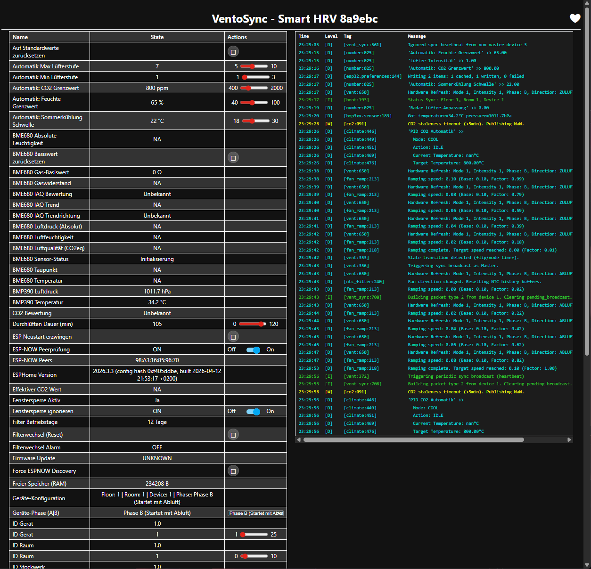
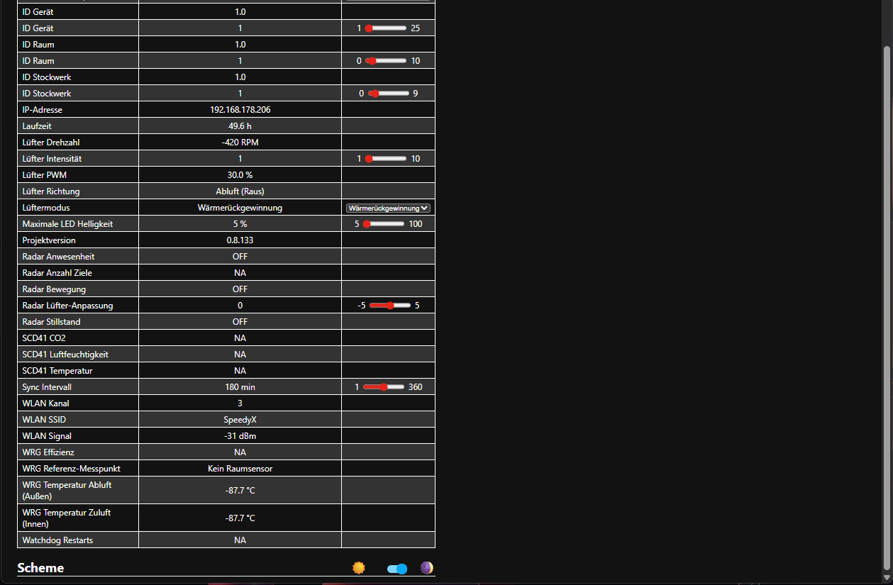

# 📊 VentoSync Lokales Web-Dashboard

Das **VentoSync Lokale Web-Dashboard** ist eine eigenständige, browserbasierte Steuer- und Diagnose-Oberfläche, die direkt vom ESP32-C6 Mikrocontroller bereitgestellt wird. Sie ermöglicht die volle Steuerung, Live-Messung und Konfiguration ganz ohne Home Assistant oder externe Server.

---

## ✨ Hauptfunktionen

* **Modernes responsives Design**: High-End Dark-Mode UI basierend auf **Tailwind CSS**, optimiert für Smartphones, Tablets und Desktop-PCs.
* **Automatik-Status-Banner** *(0.10.48)*: Die oberste Kachel zeigt, was die Lüftung gerade tut und warum — derselbe Text wie der HA-Sensor `Automatik-Status` (z. B. „CO2 erhöht: 1150 ppm (Soll 1000) → Stufe 5“), mit farbigem Rand je Grund (`automatik_grund`: rot = CO2-Notfall / Schimmelschutz / NOx, gelb = Fenster / Urlaub / Übersteuerung / keine Daten, türkis = CO2- / Feuchte-Bedarf). Darunter zeigen Chips die aktiven Raum-Eingänge: Urlaubsmodus, Fenster offen (pausiert oder Sperre ignoriert), NOx-Stoßlüftung, Stufen-Übersteuerung mit Restzeit, Anwesenheit im Raum, Status der Klima-Koordination (nur bei eingeschaltetem Schalter), Kindersicherung, Filterwechsel fällig.
* **Live-Graph**: **Chart.js**-Verlauf von Lüfter-RPM, Raumtemperatur, CO2 und relativer Feuchte der letzten ~5 Minuten (nur im Browser — nach dem Neuladen beginnt er leer).
* **Gerät & System**: Geräte-ID (mit **MASTER**-Kennzeichnung bei Gerät 1), Floor / Raum, Phase, Firmware-Version und -Variante, Laufzeit, Ursache des letzten Neustarts (Einschalten, Software-Neustart, Absturz, Watchdog, Unterspannung …), WLAN-Signal, freier RAM (und das Minimum seit dem Start). IDs und Phase werden nur angezeigt — eingestellt werden sie einmalig auf der nativen ESPHome-Seite (`/`, Link in der Kachel).
* **Einstellungen** — alle Einstellungen des Geräts, gruppiert wie in HA; **RAUMWEIT** kennzeichnet raumweite Einstellungen (per ESP-NOW verteilt):
  * *Steuerung*: Modus, Lüfterstufe, Durchlüften-Dauer (0 = unbegrenzt), Kindersicherung, Bluetooth Proxy (nur `ventosync_nosensor_btproxy`).
  * *Smart-Automatik*: Min-/Max-Stufe, CO2- und Feuchte-Grenzwert, Anwesenheits-Anpassung, Übersteuerungsdauer, Sommerkühlung-Schwelle.
  * *Klima-Koordination*: Schalter, CO2-Grenzwert, Max-Stufe, CO2-Notfallgrenze.
  * *NOx-Stoßlüftung*: raumweiter Schalter; die Schwelle nur bei den SGP41-Varianten.
  * *Urlaubsmodus*: Betriebsmodus und Stufe.
  * *Netzwerk*: ESP-NOW-Sync-Intervall.

  Zahlenfelder übernehmen ihre Grenzen vom Gerät (`/meta`); ein Wert außerhalb des HA-Slider-Bereichs wird nicht gesendet. Das Bedienelement wird kurz türkis (übernommen) oder rot (abgelehnt) umrandet.
* **Wartung**: Filter-Betriebstage, Filteralarm, lokale Radar-Präsenz und ein Button **„Filterwechsel bestätigen“** (mit Rückfrage), der den Filterzähler wie der HA-Button `Filterwechsel (Reset)` zurücksetzt.
* **Stufen-Slider in der Smart-Automatik**: Eine Stufenänderung startet die raumweite **Stufen-Übersteuerung** (wie die Stufen-Taste, Dauer `Smart-Automatik: Übersteuerung Dauer`, Standard 60 min). Ein Hinweis unter dem Slider zeigt die Restzeit (`/state`-Schlüssel `auto_override_min`); ein Moduswechsel beendet die Übersteuerung. Siehe [Smart-Automatik Logik](de_smart-automatic-logic.md#7-stufen-übersteuerung-stufen-taste).
* **SGP41 + SHT45 Sensorboard** (nur `ventosync_sgp41` / `ventosync_v2_sgp41`): Die Kachel *Luftqualität* beschriftet den CO2-Wert als **„CO2-Äquivalent (VOC)“** und zeigt zusätzlich **VOC-Index** und **NOx-Index** (`/state`-Schlüssel `voc_index`, `nox_index`, nur von diesen Varianten gesendet). Andere Varianten behalten die Beschriftung „CO2“. Die Peer-Karten zeigen weiterhin „CO2“ — das ESP-NOW-Paket enthält den Sensortyp nicht.
* **Autarker Standalone-Betrieb**: Vollständig ohne Home Assistant nutzbar. Erreichbar unter:
  * **VentoSync Dashboard**: `http://<deine-IP-Adresse>/ui` (oder `http://esptest.local/ui`)
  * **Standard-ESPHome-UI**: `http://<deine-IP-Adresse>/`

---

## 📸 Dashboard-Vorschau

### VentoSync Dashboard (Tailwind CSS UI)

  
  &nbsp;
  

*Links: Hauptsteuerung, Lüfterstufen-Slider, Betriebsmodi und Konfigurationsparameter.*  
*Rechts: Verbundene ESP-NOW-Geräte und Echtzeit-Sensorkacheln.*

---

### Standard ESPHome Dashboard

Für Low-Level-Diagnose, Firmware-Updates und detaillierte Live-Logs stellt die Root-URL (`/`) das klassische ESPHome-Webinterface bereit:

  
  &nbsp;
  

---

## 📡 ESP-NOW Visualisierung

Das Web-Dashboard scannt und visualisiert alle aktiven Lüftungsgeräte im selben Raum in Echtzeit. Die Kachel **"Verbundene Geräte (ESP-NOW)"** zeigt:
* **Geräte-ID / Node-ID**, mit **MASTER**-Kennzeichnung bei Gerät 1 und dem Alter des letzten Pakets („zuletzt vor 12 s“)
* **Status-Punkt**: türkis, solange die Daten des Peers frisch genug für die Raum-Fusion sind (≥ 5 min, zwei Heartbeats), gelb, wenn sie älter sind (die Karte bleibt bis zum 15-Minuten-Peer-Timeout)
* **Aktueller Betriebsmodus** (Automatik, WRG, Durchlüften, Stoßlüftung, Aus) — seit 0.10.48 erscheint ein Peer in der Smart-Automatik als „Automatik“ statt mit dem Modus, den er gerade fährt
* **Lüfterstufe** (1–10)
* **Aktuelle Luftrichtung** (IN / OUT; `--` im Modus Aus)
* **Raum-Eingänge dieses Geräts**: Präsenz, Fenster offen, Klima an, NOx (seine eigenen ESP-NOW-Raum-Flags)
* **Telemetrie** (Lüfter-RPM, Board-Temperatur, PID-Bedarf)
* **Luftqualität je Gerät** (CO2 in ppm, Bewertung, Temperatur, relative Luftfeuchtigkeit)

> [!NOTE]
> Die Luftqualitätswerte werden per ESP-NOW (Protokoll v11) geteilt. Jede Karte zeigt also die Messwerte des **jeweiligen** Geräts — egal ob SCD43 oder der BME680-eCO2-Fallback. Geräte ohne Klimasensor zeigen `--`; die Bewertung nutzt dieselbe Klassifizierung wie die lokale Kachel „Luftqualität", sodass beide immer übereinstimmen.

---

## 🔒 Zugriff & Sicherheit

* **Standardmäßig ohne Login** — wie die native ESPHome-Seite sind `/ui`, `/state`, `/meta` und `/set` für jeden Client im Netzwerk offen. Betreibe die Geräte in einem vertrauenswürdigen Netz (oder einem eigenen VLAN).
* **Optionaler Login** — im eigenen Build `auth:` unter `web_server:` in `packages/base/esp32c6_common.yaml` aktivieren (Zugangsdaten `webuser` / `webpw` in `secrets.yaml`). Das Dashboard registriert sich über `web_server_base::add_handler()`, daher schützt derselbe Login alle Endpunkte.
* **Keine Änderungen von fremden Seiten** *(0.10.48)* — `/set` nimmt nur `POST` mit dem Header `X-VentoSync` an (sonst `405` / `403`), und zwar nur von der Seite des Geräts selbst: Anfragen mit fremdem `Origin` werden mit `403` abgelehnt, auch bei `/state` und `/meta` (dieselbe Regel wie beim ESPHome-Webserver). Eine Webseite, die du im selben Netz öffnest, kann die Lüftung also nicht mehr über einen versteckten Link oder ein Formular umschalten. Skripte ohne Browser (`curl`) funktionieren weiter: `curl -X POST -H 'X-VentoSync: 1' -d 'id=luefter_modus&val=Aus' http://<ip>/set`.
* **Grenzen für `/set`** — nur die Schlüssel der im Dashboard gezeigten Einstellungen werden angenommen, Werte sind auf 32 Zeichen begrenzt (`400 Value too long`), Zahlen müssen numerisch sein und im Bereich der Entität liegen, und höchstens 16 Änderungen warten auf die Hauptschleife (`503 Busy`, wenn voll; das Gerät loggt pro Abarbeitung eine zusammenfassende Warnung).
* **`/state` entsteht in der Hauptschleife** (einmal pro Sekunde, solange eine Seite abfragt) und wird vom Webserver-Task nur kopiert — der Webserver liest die Peer-Liste also nie, während ESP-NOW sie ändert. Die erste Anfrage nach einer Pause antwortet ~100 ms lang mit `503`; die Seite wiederholt automatisch.

---

## 🌐 Hybrider Offline-Betrieb

> [!IMPORTANT]
> **CDN Asset-Laden**: Während alle Steuerungslogiken, PID-Regelungen und Sensorauswertungen zu 100 % lokal auf dem ESP32-C6 laufen (voll funktionsfähig auch ohne Internetverbindung), lädt das Web-Dashboard die Bibliotheken **Tailwind CSS** und **Chart.js** über ein externes CDN (`https://cdn.tailwindcss.com`...).
>
> Für die grafische Darstellung und Diagramme im Webbrowser ist daher eine aktive Internetverbindung erforderlich. Lokale Assets werden nicht im Flash-Speicher abgelegt, um den Speicherbedarf minimal zu halten.
