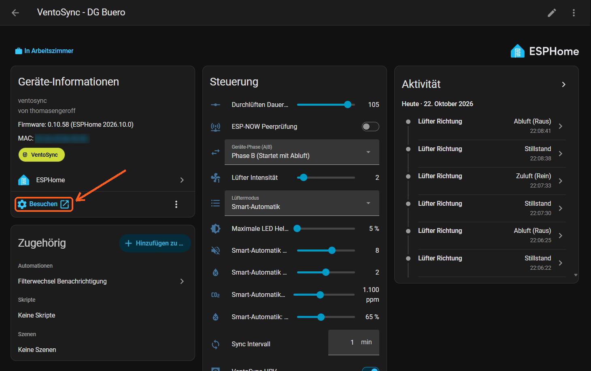
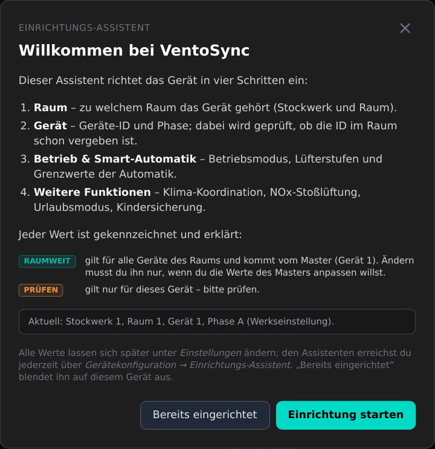
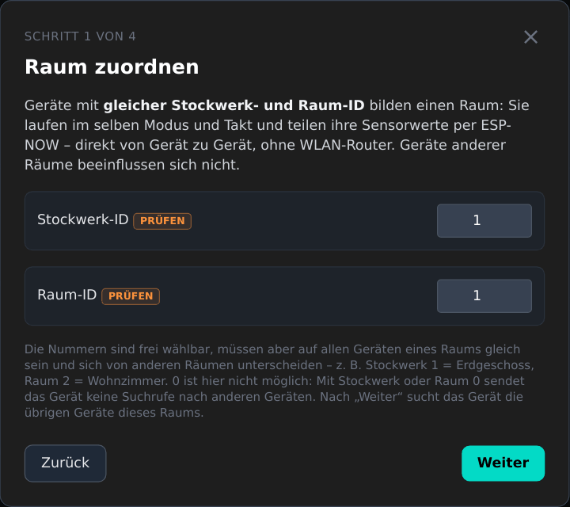
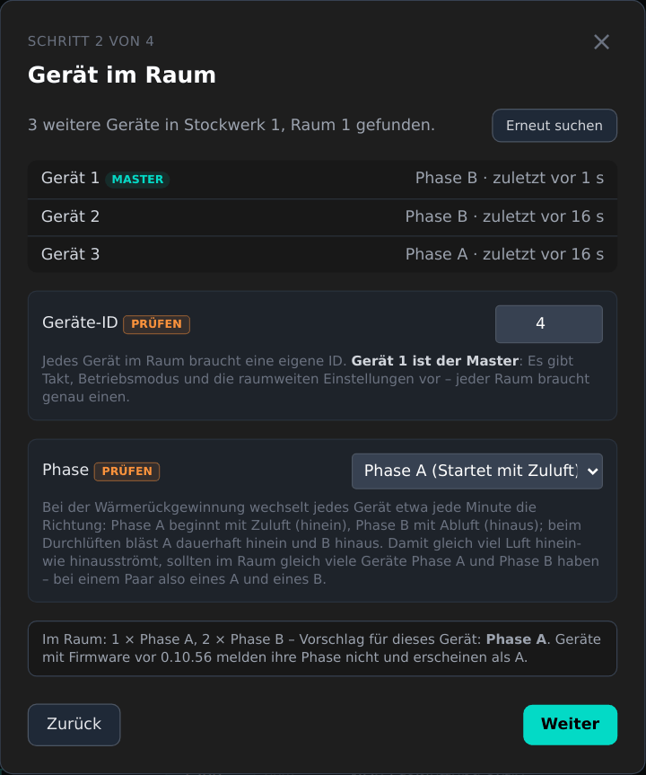
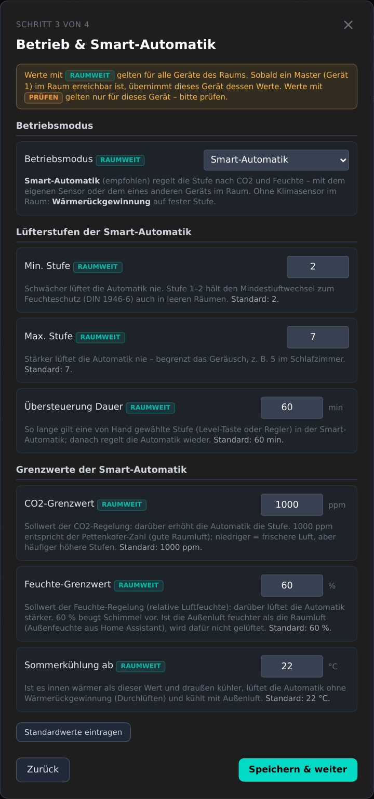
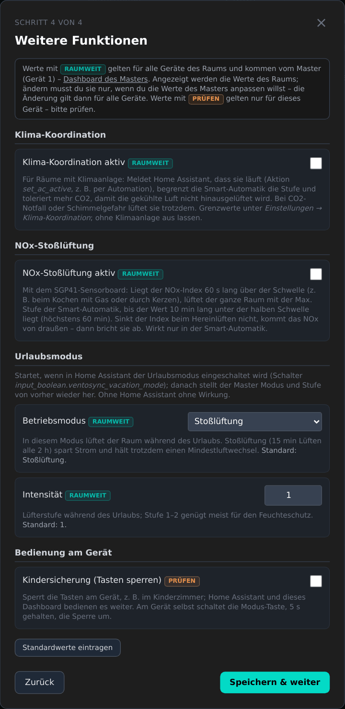
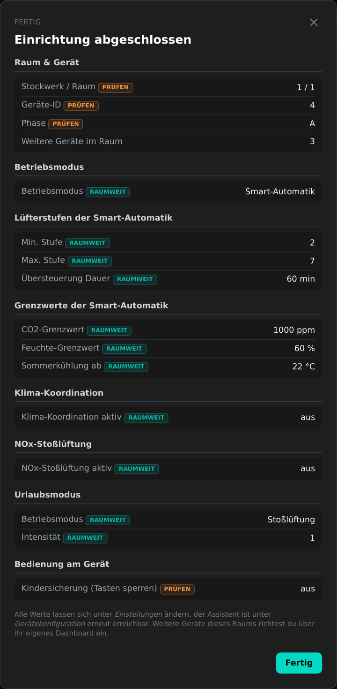
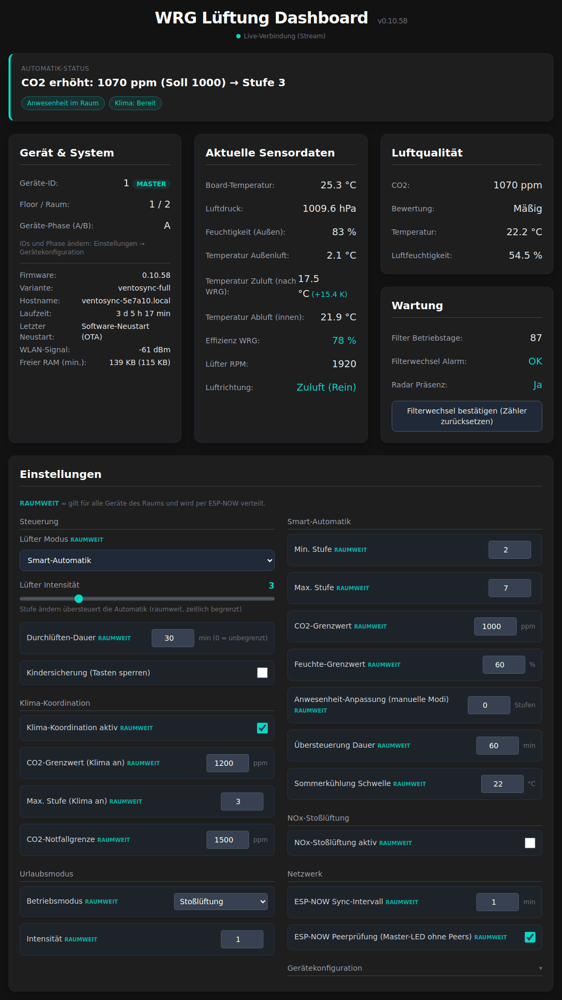
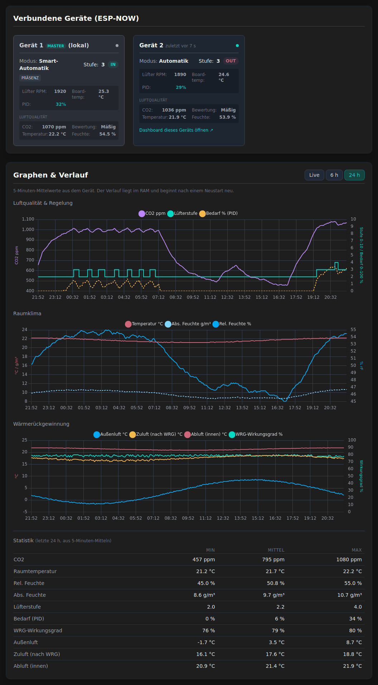

# 📊 VentoSync Lokales Web-Dashboard

Das **VentoSync Lokale Web-Dashboard** ist eine eigenständige, browserbasierte Steuer- und Diagnose-Oberfläche, die direkt vom ESP32-C6 Mikrocontroller bereitgestellt wird. Sie ermöglicht die volle Steuerung, Live-Messung und Konfiguration ganz ohne Home Assistant oder externe Server.

---

## ✨ Hauptfunktionen

* **Modernes responsives Design**: High-End Dark-Mode UI basierend auf **Tailwind CSS**, optimiert für Smartphones, Tablets und Desktop-PCs.
* **Automatik-Status-Banner** *(0.10.48)*: Die oberste Kachel zeigt, was die Lüftung gerade tut und warum — derselbe Text wie der HA-Sensor `Automatik-Status` (z. B. „CO2 erhöht: 1150 ppm (Soll 1000) → Stufe 5“), mit farbigem Rand je Grund (`automatik_grund`: rot = CO2-Notfall / Schimmelschutz / NOx, gelb = Fenster / Urlaub / Übersteuerung / keine Daten, türkis = CO2- / Feuchte-Bedarf). Darunter zeigen Chips die aktiven Raum-Eingänge: Urlaubsmodus, Fenster offen (pausiert oder Sperre ignoriert), NOx-Stoßlüftung, Stufen-Übersteuerung mit Restzeit, Anwesenheit im Raum, Status der Klima-Koordination (nur bei eingeschaltetem Schalter), Kindersicherung, Filterwechsel fällig.
* **Graphen & Verlauf** *(0.10.49)*: drei **Chart.js**-Diagramme, umschaltbar zwischen **Live** (letzte 10 Minuten, alle 2 s, nur im Browser), **6 h** und **24 h**:
  * *Luftqualität & Regelung*: CO2, Lüfterstufe (0 = Aus) und PID-Bedarf (lokaler Sensorbedarf, nur in der Smart-Automatik) — zeigt, wie die Regelung arbeitet (Hysterese, Stufensprünge).
  * *Raumklima*: Raumtemperatur, relative und **absolute Feuchte** (g/m³, Magnus-Formel wie beim Enthalpie-Schutz).
  * *Wärmerückgewinnung*: Außenluft (NTC Zuluft), Zuluft nach WRG (Innen-NTC in der Zuluft-Phase, *0.10.51*), Abluft (NTC Abluft) und WRG-Wirkungsgrad.

  Die Ansichten 6 h / 24 h kommen aus dem **Gerät** (`GET /history`): 5-Minuten-Mittelwerte der letzten 24 h in einem RAM-Ringpuffer (288 Punkte, ~5,2 KB). Sie überstehen also ein Neuladen der Seite und sind in jedem Browser gleich. Der Verlauf liegt nur im RAM (kein Flash-Verschleiß) und beginnt nach einem Neustart neu. Unter den Diagrammen zeigt eine **Statistik** Min / Mittel / Max über den gespeicherten Verlauf (bis 24 h, aus den 5-Minuten-Mitteln) für CO2, Temperatur, relative und absolute Feuchte, Lüfterstufe, Bedarf, Wirkungsgrad, Außenluft, Zuluft nach WRG und Abluft.
* **Verbindungsanzeige** *(0.10.49)*: unter dem Titel — türkis „Live-Verbindung (Stream)“, gelb „Verbunden (Abfrage alle 2 s)“ (Ausweichweg), rot „Keine Verbindung“. Kommen 6 s lang keine Daten, nennt ein roter Hinweis das Alter der angezeigten Werte („letzte Daten vor 34 s“) und die Kacheln werden abgeblendet — veraltete Werte sehen nie wie aktuelle aus. Jede Anfrage hat ein Timeout (4 s, `/history` 8 s).
* **Rückmeldung bei Änderungen** *(0.10.49)*: Eine Änderung gilt erst als bestätigt, wenn das Gerät den neuen Wert meldet (**„Gespeichert: …“**). Übernimmt das Gerät den Wert nicht innerhalb von 5 s, erscheint **„Nicht übernommen: … (aktuell …)“**; bei einer abgelehnten Anfrage der Grund (ungültiger Wert, Sicherheitsprüfung, Gerät ausgelastet, keine Verbindung), bei einer Zahl außerhalb des Gerätebereichs „Wert außerhalb min–max“. Die Meldungen erscheinen unten rechts; das Bedienelement wird wie bisher türkis / rot umrandet.
* **Gerät & System**: Geräte-ID (mit **MASTER**-Kennzeichnung bei Gerät 1), Floor / Raum, Phase, Firmware-Version und -Variante, mDNS-Hostname (*0.10.49*), Laufzeit, Ursache des letzten Neustarts (Einschalten, Software-Neustart, Absturz, Watchdog, Unterspannung …), WLAN-Signal, freier RAM (und das Minimum seit dem Start). IDs und Phase werden in der Einstellungsgruppe *Gerätekonfiguration* eingestellt (*0.10.55*).
* **Einstellungen** — alle Einstellungen des Geräts, gruppiert wie in HA; **RAUMWEIT** kennzeichnet raumweite Einstellungen (per ESP-NOW verteilt):
  * *Steuerung*: Modus, Lüfterstufe, Durchlüften-Dauer (0 = unbegrenzt), Kindersicherung, Bluetooth Proxy (nur `ventosync_nosensor_btproxy`).
  * *Smart-Automatik*: Min-/Max-Stufe, CO2- und Feuchte-Grenzwert, Anwesenheits-Anpassung, Übersteuerungsdauer, Sommerkühlung-Schwelle.
  * *Klima-Koordination*: Schalter, CO2-Grenzwert, Max-Stufe, CO2-Notfallgrenze.
  * *NOx-Stoßlüftung*: raumweiter Schalter; die Schwelle nur bei den SGP41-Varianten.
  * *Urlaubsmodus*: Betriebsmodus und Stufe, beide raumweit (*0.10.52*).
  * *Netzwerk*: ESP-NOW-Sync-Intervall, ESP-NOW-Peerprüfung (Master-LED blinkt ohne Peers, raumweit).
  * *Gerätekonfiguration* *(0.10.55)*, seit 0.10.58 standardmäßig zugeklappt (nur beim Einrichten oder Umziehen eines Geräts nötig — ein Klick auf die Überschrift öffnet sie): Stockwerk-ID, Raum-ID, Geräte-ID, Phase A/B und „Fenstersperre ignorieren“ (alle pro Gerät) sowie die Buttons **„ESP-NOW Discovery starten“** und **„Gerät neu starten“** (mit Rückfrage). Eine Änderung von Stockwerk oder Raum startet wie bei den HA-Entitäten eine neue Peer-Suche.

  Zahlenfelder übernehmen ihre Grenzen vom Gerät (`/meta`); ein Wert außerhalb des HA-Slider-Bereichs wird nicht gesendet. Das Bedienelement wird kurz türkis (übernommen) oder rot (abgelehnt) umrandet.
* **Wartung**: Filter-Betriebstage, Filteralarm, lokale Radar-Präsenz und ein Button **„Filterwechsel bestätigen“** (mit Rückfrage), der den Filterzähler wie der HA-Button `Filterwechsel (Reset)` zurücksetzt.
* **Stufen-Slider in der Smart-Automatik**: Eine Stufenänderung startet die raumweite **Stufen-Übersteuerung** (wie die Stufen-Taste, Dauer `Smart-Automatik: Übersteuerung Dauer`, Standard 60 min). Ein Hinweis unter dem Slider zeigt die Restzeit (`/state`-Schlüssel `auto_override_min`); ein Moduswechsel beendet die Übersteuerung. Siehe [Smart-Automatik Logik](de_smart-automatic-logic.md#7-stufen-übersteuerung-stufen-taste).
* **SGP41 + SHT45 Sensorboard** (nur `ventosync_sgp41` / `ventosync_v2_sgp41`): Die Kachel *Luftqualität* beschriftet den CO2-Wert als **„CO2-Äquivalent (VOC)“** und zeigt zusätzlich **VOC-Index** und **NOx-Index** (`/state`-Schlüssel `voc_index`, `nox_index`, nur von diesen Varianten gesendet). Andere Varianten behalten die Beschriftung „CO2“. Die Peer-Karten zeigen weiterhin „CO2“ — das ESP-NOW-Paket enthält den Sensortyp nicht.
* **Autarker Standalone-Betrieb**: Vollständig ohne Home Assistant nutzbar. Erreichbar unter `http://<deine-IP-Adresse>/` (oder `http://ventosync-a1b2c3.local/`); auch der Link **„Besuchen“** auf der Geräteseite in Home Assistant öffnet es. `/ui` funktioniert weiterhin (alte Lesezeichen).

> [!NOTE]
> Seit 0.10.55 ersetzt das Dashboard die native ESPHome-Seite unter `/`. ESPHomes `web_server`-Komponente bleibt nur in der Firmware (`local: false`, `log: false`), weil Home Assistant den „Besuchen“-Link aus dem gemeldeten Web-Port baut; `wrg_dashboard` startet vor ihr, daher beantwortet sein Handler `/`. Die native Entitätstabelle und die Log-Anzeige sind damit nicht mehr erreichbar — Logs über `esphome logs <variante>.yaml --device <ip>` oder das ESPHome-Add-on.

### 🏠 Dashboard aus Home Assistant öffnen

Ohne IP-Adresse oder Lesezeichen: In Home Assistant *Einstellungen → Geräte & Dienste → ESPHome* öffnen und das
VentoSync-Gerät wählen (oder eine seiner Entitäten anklicken und dann auf den Gerätenamen). In der Karte
**Geräte-Informationen** links öffnet der Link **„Besuchen“** (mit ⚙- und ↗-Symbol, unter dem Eintrag der
*ESPHome*-Integration) das Dashboard des Geräts in einem neuen Browser-Tab.

* Der Link funktioniert überall, wo der Browser die IP-Adresse des Geräts erreicht — zu Hause oder unterwegs per VPN.
  Nur über Nabu Casa / eine externe HA-URL ist das Gerät selbst nicht erreichbar.
* Jedes Gerät hat seinen eigenen Link; von dort springt man über *„Dashboard dieses Geräts öffnen ↗“* auf den
  Peer-Karten zu den anderen Geräten des Raums.
* Der Link fehlt, wenn die Firmware keinen `web_server:`-Block hat (siehe Hinweis oben) — in eigenen Konfigurationen
  beibehalten.

---

## 🧭 Einrichtungs-Assistent *(0.10.56)*

Auf einem noch nicht eingerichteten Gerät öffnet das Dashboard von selbst einen **Einrichtungs-Assistenten** — die Einrichtung vor Ort ohne Home Assistant. Er erscheint, solange das (interne) Merkmal *Einrichtung abgeschlossen* aus ist **und** Stockwerk, Raum und Geräte-ID noch auf Werkseinstellung stehen; über *Gerätekonfiguration → Einrichtungs-Assistent* ist er jederzeit erreichbar. „ד (oder Esc) verschiebt ihn auf den nächsten Aufruf, **„Bereits eingerichtet“** blendet ihn auf diesem Gerät dauerhaft aus. *Auf Standardwerte zurücksetzen* (HA-Button) setzt das Merkmal wieder zurück.

1. **Raum** — Stockwerk-ID und Raum-ID. Geräte mit gleichem Paar bilden einen Raum (gleicher Modus und Takt, geteilte Sensorwerte per ESP-NOW). 0 wird nicht angeboten: mit Stockwerk oder Raum 0 sendet ein Gerät keinen Discovery-Broadcast.
2. **Gerät im Raum** — das Gerät sucht 8 s lang die Geräte des Raums (Discovery-Broadcast + Statusanfrage; nach einem Stockwerk-/Raumwechsel wird zuerst die Peer-Liste des alten Raums verworfen) und listet sie mit ID, MASTER-Kennzeichnung und Phase.
   * **Geräte-ID**: wird laufend gegen die vergebenen IDs geprüft — eine belegte ID erscheint rot mit den freien IDs, *Weiter* bleibt gesperrt. Vorschlag: die aktuelle ID, wenn sie frei ist, sonst die kleinste freie. Hinweise „dieses Gerät wird Master“ und „kein Master (Gerät 1) im Raum gefunden“.
   * **Phase**: Vorschlag = die Phase, die weniger Geräte des Raums haben, damit gleich viel Luft hinein- wie hinausströmt (Paar: eines A, eines B). Peers melden ihre eingestellte Phase seit 0.10.56 (Raum-Flag Bit 7); ältere Firmware erscheint als A.
3. **Betrieb & Smart-Automatik** — gruppiert in *Betriebsmodus*, *Lüfterstufen der Smart-Automatik* (Min./Max. Stufe, Übersteuerungsdauer) und *Grenzwerte der Smart-Automatik* (CO2- und Feuchte-Grenzwert, Sommerkühlung-Schwelle).
4. **Weitere Funktionen** *(0.10.58)* — *Klima-Koordination* (Schalter), *NOx-Stoßlüftung* (Schalter, nur wenn ein SGP41 + SHT45 Board verbaut ist, d. h. `/state` enthält `nox_index`), *Urlaubsmodus* (Betriebsmodus und Intensität der Urlaubsvorgabe) und *Bedienung am Gerät* (Kindersicherung).
5. **Fertig** — Zusammenfassung in denselben Gruppen (plus *Raum & Gerät*: Stockwerk/Raum, ID, Master, Phase, Geräte im Raum); das Merkmal wird gesetzt.

Jeder Wert hat eine Erklärung, seine Werkseinstellung, falls es eine gibt (*Standardwerte eintragen* trägt die Werkseinstellungen des aktuellen Schritts ein, als Modus die empfohlene Smart-Automatik), und eine Kennzeichnung *(0.10.58)*:

* **RAUMWEIT** — gilt für alle Geräte des Raums und kommt vom Master (Gerät 1). Auf einem Slave zeigt der Assistent die Werte des Raums (direkt nach dem Setzen der Geräte-ID aus der Statusantwort des Masters übernommen); ändern muss man sie nur, um die Werte des Masters anzupassen, und eine Änderung gilt wie überall für den ganzen Raum.
* **PRÜFEN** (orange) — gilt nur für dieses Gerät und sollte geprüft werden: Stockwerk/Raum, Geräte-ID, Phase und Kindersicherung.

Gesendet werden nur Werte, die vom aktuellen Stand des Geräts abweichen — über denselben `/set`-Weg wie die Einstellungen (mit den üblichen Rückmeldungen).

  
  
  

  
  
  

*Oben: Willkommen mit der Legende der Kennzeichnungen, Raum, Gerät im Raum (drei Geräte gefunden, Vorschlag ID 4 und Phase A). Unten: Betrieb & Smart-Automatik, Weitere Funktionen (SGP41-Variante, daher mit NOx-Stoßlüftung), Zusammenfassung.*

---

## 📸 Dashboard-Vorschau

### VentoSync Dashboard (Tailwind CSS UI)

  
  &nbsp;
  

*Links: Automatik-Status mit Raum-Hinweisen, Gerät & System, Sensordaten, Luftqualität, Wartung und alle Einstellungen (RAUMWEIT gekennzeichnet, Gerätekonfiguration zugeklappt).*  
*Rechts: Geräte im Raum (ESP-NOW, mit Link auf ihr Dashboard), 24-h-Verlauf und Statistik.*

---

## 📡 ESP-NOW Visualisierung

Das Web-Dashboard scannt und visualisiert alle aktiven Lüftungsgeräte im selben Raum in Echtzeit. Die Kachel **"Verbundene Geräte (ESP-NOW)"** zeigt:
* **Geräte-ID / Node-ID**, mit **MASTER**-Kennzeichnung bei Gerät 1 und dem Alter des letzten Pakets („zuletzt vor 12 s“)
* **Status-Punkt**: türkis, solange die Daten des Peers frisch genug für die Raum-Fusion sind (≥ 5 min, zwei Heartbeats), gelb, wenn sie älter sind (die Karte bleibt bis zum 15-Minuten-Peer-Timeout)
* **Aktueller Betriebsmodus** (Automatik, WRG, Durchlüften, Stoßlüftung, Aus) — seit 0.10.48 erscheint ein Peer in der Smart-Automatik als „Automatik“ statt mit dem Modus, den er gerade fährt
* **Lüfterstufe** (1–10)
* **Aktuelle Luftrichtung** (IN / OUT; `--`, solange der Lüfter steht — Aus, Stoßlüftungs-Pause — oder der Peer gerade in einen anderen Modus wechselt). Seit 0.10.59 berechnet das Gerät sie aus seinem eigenen, raumweit synchronisierten Push-Pull-Zyklus und der **eingestellten Phase** A/B des Peers; sie stimmt damit jederzeit und wechselt mit dem Zyklus. Vorher zeigte die Karte die Zyklus-Phase des Raums aus dem letzten Paket des Peers (für A und B gleich, bis zu einen Heartbeat alt) und war daher meist falsch. Peers mit Firmware vor 0.10.56 melden keine Phase und erscheinen als Phase A.
* **Raum-Eingänge dieses Geräts**: Präsenz, Fenster offen, Klima an, NOx (seine eigenen ESP-NOW-Raum-Flags)
* **Telemetrie** (Lüfter-RPM, Board-Temperatur, PID-Bedarf)
* **Luftqualität je Gerät** (CO2 in ppm, Bewertung, Temperatur, relative Luftfeuchtigkeit)
* **„Dashboard dieses Geräts öffnen ↗“** *(0.10.49)*: Link zum Dashboard des Peers über seinen mDNS-Namen (`http://ventosync-a1b2c3.local/`). Jedes Gerät heißt `ventosync-<letzte 6 Hex-Stellen seiner MAC>` (`name_add_mac_suffix`), und das Dashboard kennt die MAC jedes Peers aus seinen ESP-NOW-Paketen — keine Protokolländerung. Der Link braucht einen Client, der `.local`-Namen auflöst (macOS, iOS, Windows 10+, Linux mit Avahi, aktuelles Android); sonst den Peer über seine IP öffnen.

> [!NOTE]
> Die Luftqualitätswerte werden per ESP-NOW (Protokoll v11) geteilt. Jede Karte zeigt also die Messwerte des **jeweiligen** Geräts — egal ob SCD43 oder der BME680-eCO2-Fallback. Geräte ohne Klimasensor zeigen `--`; die Bewertung nutzt dieselbe Klassifizierung wie die lokale Kachel „Luftqualität", sodass beide immer übereinstimmen.

---

## 🔒 Zugriff & Sicherheit

* **Standardmäßig ohne Login** — `/`, `/ui`, `/state`, `/stream`, `/history`, `/meta` und `/set` für jeden Client im Netzwerk offen. Betreibe die Geräte in einem vertrauenswürdigen Netz (oder einem eigenen VLAN).
* **Optionaler Login** — im eigenen Build `auth:` unter `web_server:` in `packages/base/esp32c6_common.yaml` aktivieren (Zugangsdaten `webuser` / `webpw` in `secrets.yaml`). Das Dashboard registriert sich über `web_server_base::add_handler()`, daher schützt derselbe Login alle Endpunkte.
* **Keine Änderungen von fremden Seiten** *(0.10.48)* — `/set` nimmt nur `POST` mit dem Header `X-VentoSync` an (sonst `405` / `403`), und zwar nur von der Seite des Geräts selbst: Anfragen mit fremdem `Origin` werden mit `403` abgelehnt, auch bei `/state`, `/stream`, `/history` und `/meta` (dieselbe Regel wie beim ESPHome-Webserver). Eine Webseite, die du im selben Netz öffnest, kann die Lüftung also nicht mehr über einen versteckten Link oder ein Formular umschalten. Skripte ohne Browser (`curl`) funktionieren weiter: `curl -X POST -H 'X-VentoSync: 1' -d 'id=luefter_modus&val=Aus' http://<ip>/set`.
* **Grenzen für `/set`** — nur die Schlüssel der im Dashboard gezeigten Einstellungen werden angenommen, Werte sind auf 32 Zeichen begrenzt (`400 Value too long`), Zahlen müssen numerisch sein und im Bereich der Entität liegen, und höchstens 16 Änderungen warten auf die Hauptschleife (`503 Busy`, wenn voll; das Gerät loggt pro Abarbeitung eine zusammenfassende Warnung).
* **`/state` entsteht in der Hauptschleife** (einmal pro Sekunde, solange eine Seite abfragt oder streamt) und wird vom Webserver-Task nur kopiert — der Webserver liest die Peer-Liste also nie, während ESP-NOW sie ändert. Die erste Anfrage nach einer Pause antwortet ~100 ms lang mit `503`; die Seite wiederholt automatisch.
* **Server-Sent Events statt Abfrage** *(0.10.49)* — die Seite öffnet `GET /stream` (`text/event-stream`), das Gerät schickt das `/state`-JSON alle 2 s und sofort nach einer Änderung als Ereignis `state`; keine Anfrage pro Aktualisierung. Höchstens 3 Streams gleichzeitig (weitere erhalten `503`), ein Client, der 20 s lang keine Daten annimmt, wird getrennt. Liefert der Stream 5 s lang nichts (abgelehnt, Neuverbindung, ältere Firmware), fragt die Seite stattdessen alle 2 s `/state` ab und versucht den Stream nach 30 s erneut.
* **`GET /history`** — `{"interval_s":300,"age_s":42,"scale":{"co2":1,"t":10,…},"series":{"co2":[612,…],…}}`: ältester Wert zuerst, Festkomma (durch `scale` teilen), `null` = keine Daten; der neueste Wert endete vor `age_s` Sekunden. Kanäle: `co2`, `t`, `rh`, `level`, `demand` (0–1), `eff`, `t_out`, `t_in`, `t_sup` (Zuluft nach WRG, *0.10.51*).

---

## 🌐 Hybrider Offline-Betrieb

> [!IMPORTANT]
> **Nur die Diagramme brauchen Internet**: Alle Steuerungslogiken, PID-Regelungen und Sensorauswertungen laufen zu 100 % lokal auf dem ESP32-C6. Seit *0.10.57* steckt auch die Gestaltung des Dashboards (**Tailwind CSS**) in der Firmware, die Seite ist also ohne Internetzugang vollständig — z. B. im Fallback-Hotspot. Nur **Chart.js** wird weiterhin von einem CDN geladen (`cdn.jsdelivr.net`, ~70 KB komprimiert, zu groß für den Flash der Bluetooth-Proxy-Variante); ohne Internet zeigt die Seite statt der drei Diagramme einen Hinweis.

Die Seite selbst (`components/wrg_dashboard/dashboard.html`) wird beim Build gzip-komprimiert (*0.10.49*) und mit `Content-Encoding: gzip` ausgeliefert. Seit *0.10.57* bettet der Build vorher das erzeugte Stylesheet `dashboard.css` ein (nur die Tailwind-Klassen, die die Seite nutzt, ~4 KB komprimiert), ~93 KB → ~26 KB im Flash. Nach Änderungen an Klassen in `dashboard.html` wird es mit `components/wrg_dashboard/tailwind/build_css.sh` neu erzeugt (gepinnte Tailwind-Standalone-CLI, kein Node.js) und mit eingecheckt; die CI (`lint.yaml`) schlägt fehl, solange es veraltet ist.
