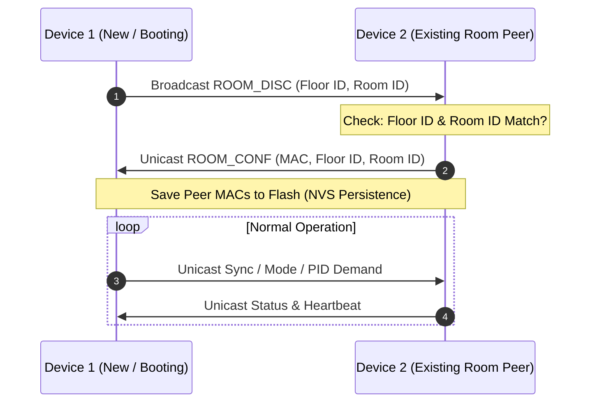

# 📡 ESP-NOW Wireless Mesh & Room Synchronization

VentoSync utilizes **ESP-NOW** (via the [ESPHome ESP-NOW Component](https://esphome.io/components/espnow.html)) for direct, ultra-low-latency device-to-device communication. ESP-NOW operates directly at the MAC layer on 2.4 GHz radio, eliminating the need for a central Wi-Fi router or physical interconnect cables.

  

---

## 💡 Architectural Decision: Why ESP-NOW over Powerline (PLC)?

Commercial systems like the original VentoMaxx rely on **Powerline Communication (PLC)** over the 230V mains power lines to synchronize paired fans. In residential environments, PLC frequently suffers from:
* Severe signal degradation and phase-crossing barriers across different electrical circuits.
* High susceptibility to switching noise and high-frequency harmonics from modern LED drivers, solar inverters, and power supplies.
* Complex installation requirements (such as needing expensive phase couplers in the sub-panel).

Standard Wi-Fi, on the other hand, creates a hard dependency on an active external router and access point availability.

**ESP-NOW** is the modern, optimal solution: it establishes a robust, highly reliable, and ultra-fast direct 2.4 GHz mesh directly between the ventilation units with zero wiring and full autonomy.

---

## ⚡ Core Advantages

* 🌐 **Complete Wi-Fi Independence**: Devices do not rely on an active Wi-Fi access point for synchronized operation. If the home router reboots or fails, all room ventilation groups continue operating synchronously without interruption.
* 🛡️ **Network Immunity**: Direct point-to-point transmission avoids Wi-Fi traffic congestion and channel interference.
* ⚡ **Microsecond-Level Latency**: Because packets require no TCP/IP handshake after discovery, directional reversal commands for paired push-pull units are transmitted synchronously and seamlessly.
* 🔌 **Zero Interconnect Cabling**: No control wiring needed between walls or across floors.
* 📡 **Dynamic Room Discovery & NVS Persistence**: Devices automatically discover other units in the same virtual room and store their peer MAC addresses directly in non-volatile flash memory (NVS).
  > [!NOTE]
  > Due to the 254-character string limit in ESPHome Globals, the persistent peer list is designed for **up to 14 peers** per device. This is more than sufficient for standard residential rooms.
* ⚙️ **Efficient Unicast Routing**: After initial discovery, all PID demand, status telemetry, and synchronization commands are transmitted via targeted unicast packets, drastically reducing RF noise in the 2.4 GHz band.
* 🔄 **Global Settings Mirroring**: Changing parameters (CO2 thresholds, fan speed levels, active modes) on any unit in the room via Home Assistant or physical buttons is mirrored wirelessly to all peers in real-time.

---

## 🔍 Discovery & Pairing Process

1. **Broadcast (`ROOM_DISC`)**: A booting device or one whose Room/Floor ID changed broadcasts a discovery frame to `FF:FF:FF:FF:FF:FF`.
2. **Matching**: Receiving devices check whether the packet's Floor ID and Room ID match their own.
3. **Handshake (`ROOM_CONF`)**: If matched, the receiver adds the sender as a peer and responds with a direct unicast confirmation.
4. **Persistence**: The peer list is stored in NVS, allowing instantaneous synchronization upon subsequent reboots without waiting for discovery.

---

## 🔒 Protocol Architecture & Packet Validation (v16)

* **Frame Authentication (v13)**: every frame — state packets, heartbeats and the discovery strings, unicast and broadcast — carries a 16-byte trailer with a frame counter and an HMAC-SHA256 tag (see *Security* below). Frames without a valid tag or with an outdated counter are dropped before anything is parsed. Firmware ≥ 0.10.43 rejects v12 frames — **flash all devices of a room** and give them the same `espnow_key`.
* **Magic Header Validation**: Every packet begins with a fixed magic byte (`0x42`) to immediately discard foreign or malformed 2.4 GHz packets.
* **Firmware Version Guard**: Strict version validation ensures that packets from incompatible firmware builds are rejected cleanly.
* **Loop Prevention**: adopted values are applied without a new broadcast (`notify = false`), and devices only broadcast their **own** inputs, never a value fused from peers — so mirrored settings and room-wide maxima cannot ping-pong or latch between devices. (There are no sequence numbers in the packet.)
* **Level override (v12)**: every packet carries the room's Smart-Automatik level override (`auto_override_level`, `auto_override_remaining_s`). `MSG_STATE` from any device starts, changes or ends it; the Master heartbeat only starts / re-aligns it. Firmware ≥ 0.10.34 rejects v11 packets — **flash all devices of a room**.
* **Vacation preset (v14)**: every packet carries the room-wide vacation preset (`vacation_preset_mode_index`, `vacation_preset_level`), adopted like the sliders from `MSG_STATE` and the Master heartbeat. Firmware ≥ 0.10.52 rejects v13 packets — **flash all devices of a room**.
* **Summer cooling threshold (v15)**: every packet carries the room-wide `Smart-Automatik: Sommerkühlung Schwelle` (`summer_cooling_threshold`, 18–30 °C), adopted like the sliders from `MSG_STATE` and the Master heartbeat. Firmware ≥ 0.10.54 rejects v14 packets — **flash all devices of a room**.
* **Device name (v16)**: every packet carries the sender's own `Gerätename` (`device_name`, 32 bytes UTF-8, NUL-padded, empty = none), shown on the peer cards of the other devices' dashboards. Display only — never adopted or re-broadcast; `parse()` terminates the field instead of rejecting the packet. Firmware ≥ 0.10.60 rejects v15 packets — **flash all devices of a room**.

---

## 🔐 Security: Authenticated, Not Encrypted

Since 0.10.43 (protocol v13) every ESP-NOW frame is **authenticated** with a room key, but **not encrypted**.

**How it works** (`components/ventilation_logic/espnow_auth.h`, unit-tested):

* Trailer `epoch (4) | seq (4) | tag (8)` on every frame. `tag` = first 8 bytes of HMAC-SHA256(key, sender MAC ‖ payload ‖ epoch ‖ seq).
* The key is derived at compile time (SHA-256) from `espnow_key` in `secrets.yaml`; the firmware does not contain the passphrase itself. Release firmware uses the repository secret `ESPNOW_KEY`.
* `epoch` is incremented and written to flash once per boot, `seq` per frame. Each device remembers the newest `(epoch, seq)` per sender and drops anything older (replay protection). The sender MAC is part of the tag, so a captured frame cannot be replayed under another address.
* Rejected frames are counted; the log shows one summary warning per minute (`espnow_auth: Dropped N unauthenticated ESP-NOW frame(s); last from …: bad tag / unsigned / replayed`).

**What it protects against:** a nearby device without the key can no longer switch the room's mode, change its level or room-wide settings, or pause the fans via the window flag — neither with forged frames nor by replaying recorded ones.

**Remaining limitations:**

* **Readable**: the payload is not encrypted — anyone within radio range can still read mode, fan level, CO2, humidity and temperatures.
* **Key in release firmware**: the key is compiled into the firmware. For the public GitHub releases it is the same for every user and can be extracted from the binary with some effort — the same limitation as the API key (README *OTA Security*). For real protection build the firmware yourself with your own `espnow_key` (`esphome run` / `upload_all.sh`) and do not install GitHub releases on those devices.
* **Replay window after silence or reboot**: the replay memory lives in RAM. After a device reboots — or after a sender was silent for longer than the replay expiry (15 minutes, or two heartbeats if the ESP-NOW sync interval is longer than 7.5 min, e.g. 1 h at a 30 min interval) — the first frame of each sender is accepted even if it is an old recording; the sender's next genuine frame (next heartbeat) supersedes it. The expiry lets a device whose flash was erased (USB flash, counter restarts) rejoin its room without rebooting the others; until then its frames are dropped.
* **All devices of a room need the same key** — devices with another key ignore each other (log: *bad tag*). Neighbouring VentoSync installations with their own key are therefore separated by more than just the Floor/Room ID.
* **Why not ESP-NOW's built-in encryption?** ESPHome (checked up to 2026.10.0) always adds peers unencrypted, the built-in encryption only covers unicast (discovery and status requests are broadcasts) and is limited to a few encrypted peers.

---

## 📶 RF & Antenna Optimization

To guarantee reliable wireless reach through concrete walls, drywall, and ceilings:
* **U.FL External Antenna**: The ESP32-C6 is equipped with an external omnidirectional antenna connected via U.FL.
* **Antenna Switching**: ESPHome firmware is configured to route all RF signals through the external antenna connector rather than the small on-board PCB antenna, providing superior signal strength and link margins.
