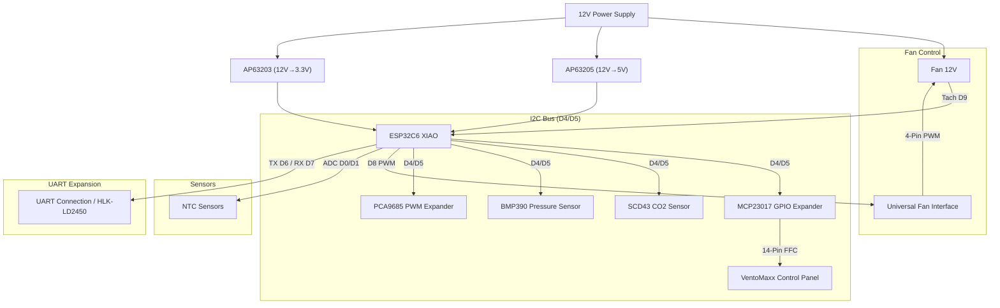

# 🛠️ Hardware, Bill of Materials (BOM) & Wiring

This document provides detailed specifications of the central hardware components, actuators, environmental sensors, control panel connection, pin assignments, and schematic architecture for VentoSync.

---

## 🛠️ Hardware & Bill of Materials (BOM)

### Central Unit

| Component | Description |
| :--- | :--- |
| **MCU** | [Seeed Studio XIAO ESP32C6](https://wiki.seeedstudio.com/xiao_esp32c6_getting_started/) (RISC-V, WiFi 6, Zigbee/Matter ready) |
| **Power** | TRACO POWER TMPS 10-112 (230VAC to 12VDC, 10W)  – **Premium Choice:** Certified according to **EN 60335-1** (household appliances) and **EN 62368-1** (IT/industry). The choice fell on this high-end module from Traco Power (Switzerland) because it offers maximum safety through its double insulation (**protection class II**) and high insulation voltage (4kV). Unlike inexpensive power supplies, it meets the strict EMC requirements of **Class B** without external filters and is designed for maintenance-free continuous operation (>10 years) in residential spaces. |
| **DC/DC** | Diodes Inc. AP63205 (12V->5V) & AP63203 (12V->3.3V)  – **Custom Development:** These two professional step-down converters (Buck Converters) were implemented directly on the PCB for high-efficiency energy conversion (up to 94% efficiency). They ensure an extremely stable power supply for MCU and sensors with minimal heat generation – a key factor for the long-term stability of the system in continuous operation. |

### Actuators & Sensors

| Component | Description | Documentation |
| :--- | :--- | :--- |
| **Fan** | The original VentoMaxx V-WRG units use the **EBM-PAPST 4412 F/2 GLL (VarioPro)** **3-Pin PWM** (without tachometer signal) fan. Alternatively, a much more modern and quieter **AxiRev** (4-Pin PWM) can be used. For this, however, you would have to handle the mounting via a 3D-printed adapter. *Wiring shown below.* | [Fan Component](https://esphome.io/components/fan/speed.html) |
| **SCD43** | Sensirion CO2 sensor (Real CO2 400-5000ppm, Temp, Hum) via I²C. Plug-in sensor board for H2 (PCB v1 and v2). Firmware with the SCD43 board as the only climate sensor: `ventosync_scd43_only.yaml` (PCB v1) / `ventosync_v2_scd43_only.yaml` (PCB v2); `ventosync.yaml` additionally expects BME680 + LD2450 | [SCD4X Component](https://esphome.io/components/sensor/scd4x.html) |
| **SGP41 + SHT45** | Alternative plug-in sensor board for H2 (PCB v1 and v2, instead of the SCD43 board): Sensirion SGP41 VOC/NOx index + SHT45 temperature/humidity via I²C (0x59 / 0x44, **3.3 V only**). Firmware `ventosync_sgp41.yaml` (PCB v1) / `ventosync_v2_sgp41.yaml` (PCB v2) — the SHT45 provides room temperature/humidity, the VOC index is mapped to a CO2 equivalent for Smart-Automatik. | [SGP4x](https://esphome.io/components/sensor/sgp4x.html), [SHT4x](https://esphome.io/components/sensor/sht4x.html) |
| **BMP390** / **BMP388** | Bosch high-precision barometric pressure sensor via I²C — BMP390 on PCB v1, BMP388 on PCB v2 (pin- and driver-compatible, same address 0x76; the BMP390 was not available at JLCPCB) | [BMP3XX Component](https://esphome.io/components/sensor/bmp3xx.html) |
| **BME680** | Bosch gas sensor (fallback for IAQ/air quality) via I²C | [BME680 Component](https://esphome.io/components/sensor/bme680.html) |
| **NTCs** | 2x NTC 10k (Supply Air/Exhaust Air) for efficiency measurement | [NTC Sensor](https://esphome.io/components/sensor/NTC.html) |
| **I/O Expander** | **MCP23017** (I2C) for VentoMaxx panel | [MCP23017](https://esphome.io/components/mcp23017.html) |
| **LED Driver** | **PCA9685** (I2C) for dimmable LEDs in VentoMaxx panel | [PCA9685](https://esphome.io/components/output/pca9685.html) |

*Fan connector wiring, with original cable.*

The complete Bill of Materials (BOM) is located in the [EasyEDA-Pro](../../EasyEDA-Pro/) subfolder in the [BOM](../../EasyEDA-Pro/BOM_VentoSync_PWM_PCB_VentoSync-WRG_ESP32_PWM_2026-03-01.csv).

### 🌿 SGP41 + SHT45 Sensor Board: VOC & NOx

**Which board for which room?**

- **SCD43 board** – for all rooms where the air quality is mainly determined by the **CO₂ exhaled by people**: living room, bedroom, children's room, home office.
- **SGP41 + SHT45 board** – mainly for the **kitchen** and rooms with an **open fireplace, wood stove or other combustion appliances**. There, cooking fumes, odours and combustion gases (NOx) spoil the air while the CO₂ level often stays low. It also suits bathrooms (humidity + odours).

Firmware: SCD43 board `ventosync_scd43_only.yaml` (PCB v1) / `ventosync_v2_scd43_only.yaml` (PCB v2); SGP41 + SHT45 board `ventosync_sgp41.yaml` (PCB v1) / `ventosync_v2_sgp41.yaml` (PCB v2).

**What is NOx?** NOx stands for **nitrogen oxides**, mainly nitric oxide (NO) and nitrogen dioxide (NO₂). They are formed by combustion at high temperature:

- **Indoors:** gas hob and gas oven (the main source), a gas boiler with a flue problem, candles, open fireplace / wood stove, cigarettes.
- **Outdoors:** mainly road traffic (diesel exhaust) – it gets in through open windows or the ventilation.

NO₂ irritates the airways and matters especially for asthmatics and children, which is why the outdoor air has legal limits for it.

**What the SGP41 reports:** no concentration (no ppb or µg/m³), but an **index of 1–500**. Sensirion's algorithm compares the current signal with what it has learned over the last hours:

| NOx index | Meaning (rough guide) |
|---|---|
| **1** | Normal, no NOx event – the value you see most of the time |
| **~2–20** | Slight increase, e.g. a candle or some traffic air |
| **~20–150** | Clear event – typical when cooking on a gas hob |
| **> 150** | Heavy load, e.g. several gas burners for a long time or smoke |

These bands are rules of thumb, not official limits: an index of 50 does not mean "50 ppb", only "clearly more than the learned normal state".

**VOC index vs. NOx index:**

- **VOC index:** normal state = **100**; below means better than usual, above worse. Reacts to odours, cooking fumes, cleaning agents, outgassing and people. Firmware: mapped to a CO₂ equivalent (`400 + 4 × (index − 50)`, 400–2200 ppm) that drives the CO₂ regulation of Smart-Automatik.
- **NOx index:** normal state = **1**, because there is usually no NOx at all. Only rises with combustion events. Firmware: shown in Home Assistant (`sensor.sgp41_nox_index`) and drives the optional **NOx boost** (switch `NOx-Stoßlüftung`, off by default).

After power-up the algorithm needs a few minutes before it reports values (NOx somewhat longer than VOC), and several hours to learn the room's air – do not over-interpret the first readings after flashing.

**NOx boost (since 0.10.38):** in Smart-Automatik, a NOx index above the threshold (HA number `NOx-Stoßlüftung: Schwelle`, 20–100) for 60 s raises the room's fan to the automatic maximum level; it ends 10 min after the index has fallen below half the threshold (max. 60 min). Because the NOx can also come from **outdoors** (road traffic), the boost is **aborted immediately** if the index does not fall while the device blows outdoor air in. The room-wide switch `NOx-Stoßlüftung` is **off by default** — enable it in rooms with a gas hob or fireplace. Details: [Smart Automatic Logic – NOx boost](en_smart-automatic-logic.md#8-nox-boost-sgp41--sht45-board-since-01038).

### 🔌 PCB v2.0 Expansion Connectors (JST SH)

All expansion connectors of PCB v2.0 are **JST SH** (1.0 mm pitch, vertical, SMD). The I²C lines on U36 and CN4 are the **same 3.3 V bus** as the sensor board at H2 (4.7 kΩ pull-ups on the main board), so an additional external I²C sensor can be connected to either of them.

| Connector | Position | Assignment (silkscreen) | Part on the board | Mating connector (cable side) |
| :--- | :--- | :--- | :--- | :--- |
| **U36** – expansion | – | GND · 3V · GPB0 · GPB1 · GPB2 · GPB3 · SCL · SDA (8-pin) | JST BM08B-SRSS-TB | JST **SHR-08V-S-B** housing + **SSH-003T-P0.2** crimp contacts (AWG 28–32) |
| **CN4** – I²C | right board edge, below CN5 | GND · 3V3 · SCL · SDA (4-pin) | JST BM04B-SRSS-TB | JST **SHR-04V-S-B** housing + **SSH-003T-P0.2** crimp contacts |
| **CN5** – radar (UART0) | right board edge, above CN4 | 5V · GND · TX · RX (4-pin) | JST BM04B-SRSS-TB | JST **SHR-04V-S-B** housing + **SSH-003T-P0.2** crimp contacts |

- **Cables:** crimping the tiny SH contacts needs a special tool — pre-crimped JST SH 1.0 mm cables (single leads or 4/8-pin cables with a housing on one or both ends) are the practical choice.
- **Qwiic / STEMMA QT:** these cables also use 4-pin JST SH, but with the pin order GND · 3V3 · **SDA · SCL**. Compare with the silkscreen of CN4 before plugging one in — swapped SDA/SCL does no damage, but the sensor will not respond.
- **I²C addresses already in use:** 0x40 (PCA9685), 0x76 (BMP388), 0x77 (BME680) and the sensor board at H2 (SCD43 0x62 or SGP41 0x59 + SHT45 0x44). An external sensor needs a free address and its own ESPHome configuration — the firmware variants do not include one.
- **GPB0–GPB3** (U36) are IO4, IO5, IO14 and IO15. IO4, IO5 and IO15 are ESP32-C6 strapping pins: external circuitry must not force a fixed level on them during reset.

### 🖱️ On-Device Control Panel

| Component | Description | Documentation |
| :--- | :--- | :--- |
| **VentoMaxx Panel** | Original panel (14-Pin FFC). 3 buttons, 9 LEDs (dimmable via PCA9685). | The pinout of the original panel was completely measured and documented by me to enable exact control via the custom PCB and the port expanders (MCP23017/PCA9685). |

---

## 🔌 Pin Assignment & Wiring

The system is based on the [Seeed XIAO ESP32C6](https://wiki.seeedstudio.com/xiao_esp32c6_getting_started/).

⚠️ **IMPORTANT:** The fan runs on 12V, the logic on 3.3V or 5V (radar sensor). Corresponding voltage dividers and protection circuits are present.

| XIAO Pin | GPIO | Function | Remark |
| :--- | :--- | :--- | :--- |
| **D0** | GPIO0 | [ADC Input](https://esphome.io/components/sensor/adc.html) | NTC Outside (Exhaust Air) |
| **D1** | GPIO1 | [ADC Input](https://esphome.io/components/sensor/adc.html) | NTC Inside (Supply Air) |
| **D2** | GPIO2 | Output | **MCP23017 Reset** |
| **D3** | GPIO21 | Output | **PCA9685 OE** (Output Enable) |
| **D4** | GPIO22 | [I2C SDA](https://esphome.io/components/i2c.html) | SCD43, BMP390, PCA9685, MCP23017 |
| **D5** | GPIO23 | [I2C SCL](https://esphome.io/components/i2c.html) | SCD43, BMP390, PCA9685, MCP23017 |
| **D6** | GPIO16 | [UART RX](https://esphome.io/components/uart.html) | **HLK-LD2450 Radar RX** |
| **D7** | GPIO17 | [UART TX](https://esphome.io/components/uart.html) | **HLK-LD2450 Radar TX** |
| **D8** | GPIO19 | [PWM Output](https://esphome.io/components/output/ledc.html) | **Fan PWM Primary** |
| **D9** | GPIO20 | [Pulse Counter](https://esphome.io/components/sensor/pulse_counter.html) | **Fan Tach** (Pullup via 3V3) |
| **D10** | GPIO18 | - | Not connected (NC) |

### 📊 Schematic Representation (Concept)

